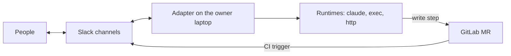

# pipe.ai

pipe.ai connects the coding agents of different owners through Slack.
Each owner runs one adapter on their own laptop. The adapter reads Slack events and runs `claude -p`.

The agents can review work, report who works on what, and do delegated work in the repository of a different owner.
There is no server, database, or web UI. The project is an MVP experiment.

## Status

> **Implemented:** specs 001 to 007 in the adapter. Unit and integration tests use fakes.
>
> **NOT tested:** live Slack, a live `claude` CLI, a live GitLab, live wiz-review, and `launchctl`.
>
> **Not implemented:** spec 008. The release note and the real library repository of spec 007.

### Known defects

These items come from a read of the code.

| Item | Effect |
|---|---|
| The launcher that `pipe schedule --install` writes ignores its arguments. It always runs `pipe run`. | Do not use `~/.pipe/bin/pipe` for the status hook. It starts a second adapter. Use `<REPO>/.venv/bin/pipe`. |
| `templates/review/wiz_review_capability.py` reads `mr_url` and `artifacts` at the top level of stdin. The `exec` runtime puts them under `payload`. | The wrapper fails with `missing change link`. The step shows `exit 2`. The wrapper does not work as shipped. |
| `dialog_timeout_h` is in [the reference](docs/reference.md), but `config.py` does not read it. | The dialog timeout is always 24 hours. |
| `flows_dir` and `runtime.name` are in the reference, but `config.py` does not read them. | These keys have no effect. |
| The launchd launcher exports only `PATH`. | Variables in `env_allow` of an `exec` capability can be empty under launchd. |
| A missing status channel is not handled at start. | `pipe run` stops with an error. |
| The code has no handler for `message.channels`. | A subscription to that event does nothing. |

## Overview



## Quick start

First create the Slack app ([Set up Slack](docs/guides/setup-slack.md)) and `~/.pipe/config.yaml`
([Install and configure](docs/guides/install-and-config.md)).

```sh
python3.15 -m venv .venv
.venv/bin/pip install -e ".[test]"
mkdir -p -m 700 ~/.pipe
security add-generic-password -U -s <SERVICE> -a bot -w <BOT_TOKEN>
security add-generic-password -U -s <SERVICE> -a app -w <APP_TOKEN>
.venv/bin/pipe doctor
.venv/bin/pipe run
```

## Documents

| Document | Content |
|---|---|
| [Index](docs/README.md) | All documents. |
| [Architecture](docs/guides/architecture.md) | Components, ports, trust model. |
| [Flows](docs/guides/flows.md) | Sequence diagrams and the flow catalog. |
| [Install and configure](docs/guides/install-and-config.md) | Requirements, config keys, Keychain. |
| [Set up Slack](docs/guides/setup-slack.md) | Apps, channels, trigger bot. |
| [Run and operate](docs/guides/run-and-operate.md) | Commands, launchd, logs, problems. |
| [Add capabilities and flows](docs/guides/add-capabilities-and-flows.md) | Expose, declare, tag, templates. |
| [Security](docs/guides/security.md) | Trust rules, owner gate, residual risks. Read before real use. |
| [Development](docs/guides/development.md) | Tests, layout, core boundary. |

## Tests

```sh
make ci      # lint and tests
make lint
make test
```

## License

MIT. See [LICENSE](LICENSE).
