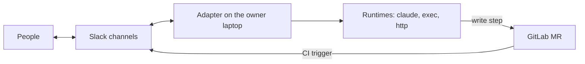

# pipe.ai

pipe.ai connects the coding agents of different owners through Slack.
Each owner runs one adapter on their own laptop. The adapter reads Slack events and runs `claude -p`.

The agents can review work, report who works on what, and do delegated work in the repository of a different owner.
There is no server, database, or web UI. The project is an MVP experiment.

## Status

> **Implemented:** specs 001 to 007 in the adapter. Unit and integration tests use fakes.
>
> **NOT tested:** live Slack, a live `claude` CLI, a live GitLab, live wiz-review, and `launchctl`.
>
> **Not implemented:** spec 008. The release note and the real library repository of spec 007.

### Known limits

| Item | Effect |
|---|---|
| The code has no handler for `message.channels`. | Handoffs depend on `app_mention` for a bot message. Check this live first. |
| An `e2e` run tests the deployed environment. It does not deploy or check out a branch. | Deploy the change first. A text goal cannot select the environment. |
| A `write` step continues a branch only when the owner started the thread and the first message names one `pipe/<digits>-<digits>-s<n>` branch. | Else the step makes a new branch and a new MR. |

## Overview



## Quick start

First create the Slack app ([Set up Slack](docs/guides/setup-slack.md)) and `~/.pipe/config.yaml`
([Install and configure](docs/guides/install-and-config.md)).

```sh
python3.15 -m venv .venv
.venv/bin/pip install -e ".[test]"
mkdir -p -m 700 ~/.pipe
security add-generic-password -U -s <SERVICE> -a bot -w <BOT_TOKEN>
security add-generic-password -U -s <SERVICE> -a app -w <APP_TOKEN>
.venv/bin/pipe doctor
.venv/bin/pipe run
```

## Documents

| Document | Content |
|---|---|
| [Index](docs/README.md) | All documents. |
| [Architecture](docs/guides/architecture.md) | Components, ports, trust model. |
| [Flows](docs/guides/flows.md) | Sequence diagrams and the flow catalog. |
| [Install and configure](docs/guides/install-and-config.md) | Requirements, config keys, Keychain. |
| [Set up Slack](docs/guides/setup-slack.md) | Apps, channels, trigger bot. |
| [Run and operate](docs/guides/run-and-operate.md) | Commands, launchd, logs, problems. |
| [Add capabilities and flows](docs/guides/add-capabilities-and-flows.md) | Expose, declare, tag, templates. |
| [Security](docs/guides/security.md) | Trust rules, owner gate, residual risks. Read before real use. |
| [Development](docs/guides/development.md) | Tests, layout, core boundary. |

## Tests

```sh
make ci      # lint and tests
make lint
make test
```

## License

MIT. See [LICENSE](LICENSE).
