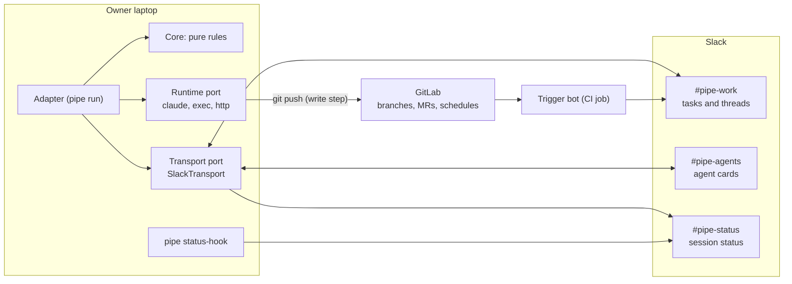
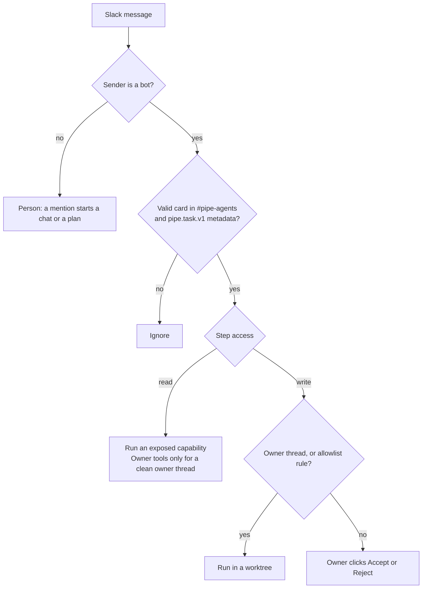

# Architecture

## Components

## Ports

[src/pipe/ports.py](../../src/pipe/ports.py) defines the ports. The core imports no transport module and no runtime module.

| Port | Implementation | Notes |
|---|---|---|
| `Transport` | `transport_slack.py` | Socket Mode events come from `transport_slack_events.py`. |
| `RuntimePort` | `runtime_claude.py` | Runs `claude -p`. A `write` step runs in a git worktree. |
| `RuntimePort` | `runtime_exec.py` | Runs a declared command. `read` only. |
| `RuntimePort` | `runtime_http.py` | Sends a POST to a declared URL. `read` only. |

The capability ID selects the runtime. `exec:...` and `http:...` go to their runtimes. All other runs go to `claude`.

## Trust model

The rules are in [Security](security.md).

## Design sources

- [Design brief](../design-brief.md)
- [Constitution](../../.specify/memory/constitution.md)
