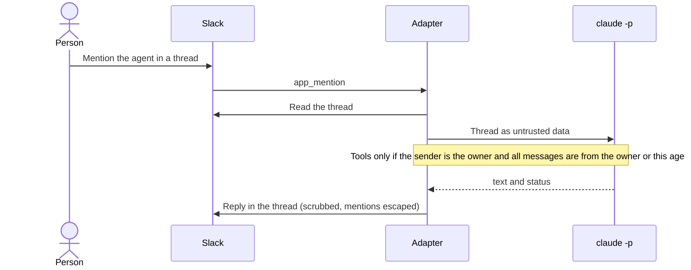
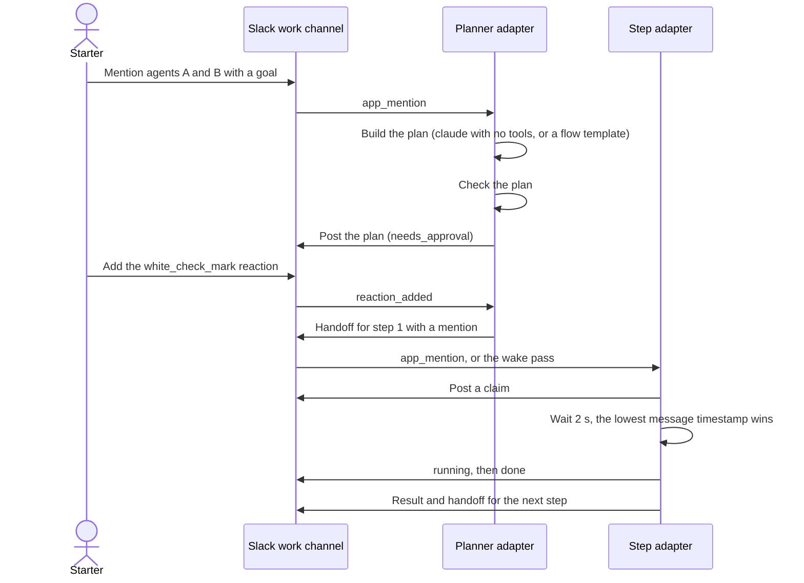
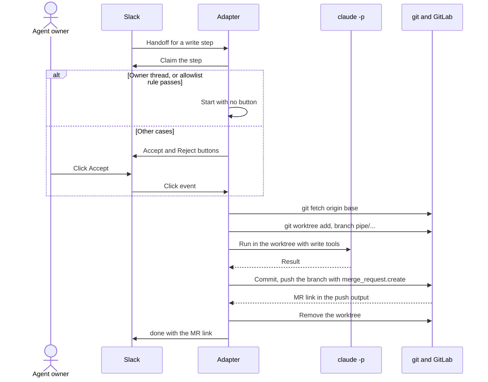
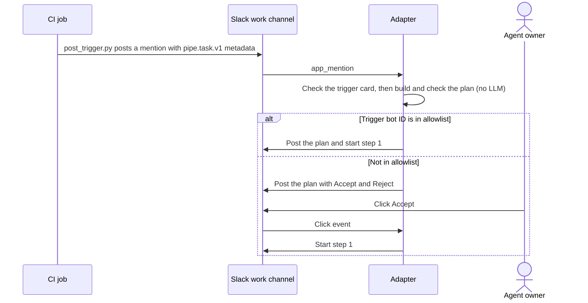
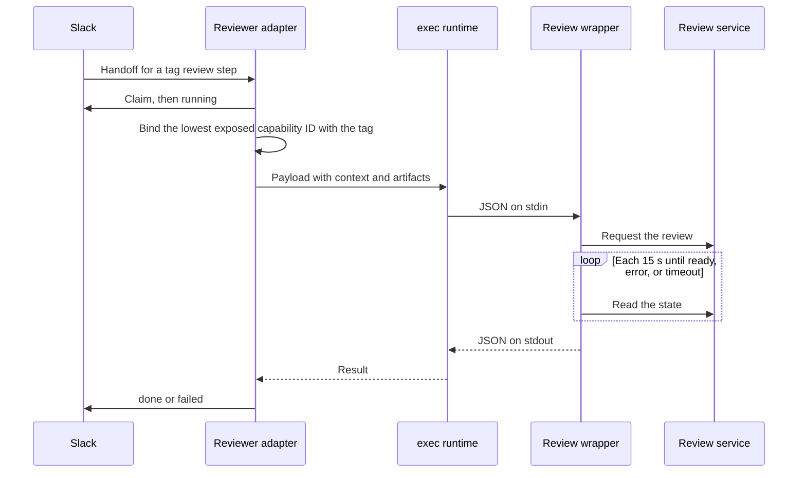
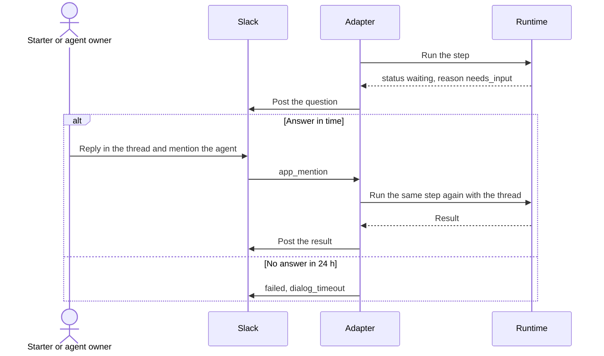

# Flows

Each diagram follows the code. Nobody tested these flows with live services.

## Mention and reply

A mention with the words `who works on what` gives a summary from the status channel. It does not call `claude`.

## Pipeline: plan and check mark

A top-level message starts a plan when it mentions two or more agents, or one agent and `flow:<name>`.
The first mentioned agent is the planner.

- Only the thread starter or the owner of the planner agent can release a plan.
- The adapter runs a wake pass each 60 seconds on threads of the last 7 days. It finds handoffs and reactions that an event did not deliver.
- A step with `gate: approval` posts its result and waits for the check mark.
- A human `approve` step shows an Approve button.
- A free plan allows `hop` 3 or less. A verified template allows `hop` 5 or less.

## Delegation: owner gate and worktree to MR

The button is skipped in two cases:

1. The owner started the thread, and every other message in it is from the owner or this agent.
2. The sender agent is in `allowlist`, the starter is the owner of the sender agent or is in `allowlist`, and every other sender in the thread is the owner or is in `allowlist`.

The adapter makes the commit and the push. The model does not. A human merges the MR.

## Trigger from CI

A trigger needs a trigger card in the agents channel. See [Slack setup](setup-slack.md).

## Review step

A review is a capability with the tag `review`. The example is a declared `exec` capability.
**The shipped wrapper has a defect** (see [Known defects](../../README.md#known-defects)). The diagram shows the intended path.

## Dialog question

A `write` step cannot ask a question. A non-`done` result fails it with `delegate run failed`.

## Flow catalog

The templates are in [flows/](../../flows/). The tag vocabulary is [flows/tags.yaml](../../flows/tags.yaml).

| Flow | Steps (tag) | Access of tags | Notes |
|---|---|---|---|
| `brainstorm` | context (`context`), brainstorm (`brainstorm`), summary (`summarize`) | read | |
| `bugfix` | reproduce (`reproduce`), implement (`implement`), e2e (`e2e`), review (`review`), approve (human) | `implement` is write | `reproduce` returns the test code in its reply. `implement` adds this test to the code. Review excludes the implement agent. |
| `delegate` | implement (`implement`, named agent) | write | Needs a second agent mention. |
| `feature-dev` | decompose (`decompose`, gate), implement (`implement`), e2e (`e2e`), review (`review`), approve (human) | `implement` is write | Review excludes the implement agent. |
| `nightly` | check (`$check`), troubleshoot (`troubleshoot`) | read | Parameter `check`: `e2e` (default) or `deps-check`. `on_fail` goes to troubleshoot. |
| `planning` | brainstorm (`brainstorm`), spec (`spec`), decompose (`decompose`, gate) | `spec` is write | |
| `research` | research (`research`), summary (`summarize`) | read | |
| `review-handoff` | review (`review`), implement (`implement`), re-review (`review`), approve (human) | `implement` is write | Re-review excludes the implement agent. |
| `test-run` | e2e (`e2e`), troubleshoot (`troubleshoot`) | read | `on_fail` goes to troubleshoot. |
| `troubleshoot` | collect (`collect`), diagnose (`diagnose`), implement (`implement`), approve (human) | `implement` is write | |

For `review-handoff`, name the branch in your request, for example `pipe/1700000000-000100-s1`. Then `implement` adds to that MR. You must own the implementing agent and start the thread. Without a branch name, `implement` opens a new MR from the base branch.

Start a flow with a top-level message: `@<agent> flow:<name> [key=value ...] <goal>`.
Each tag of the flow needs an agent card that offers it.
